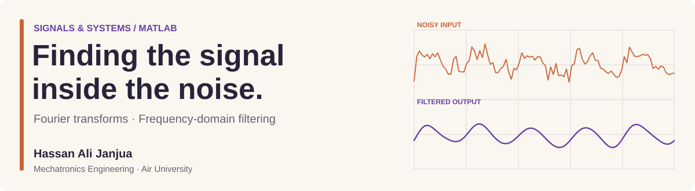
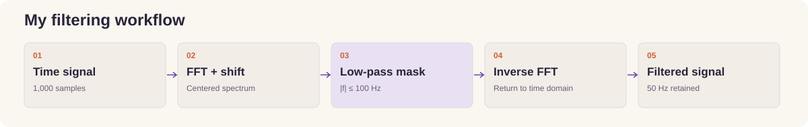
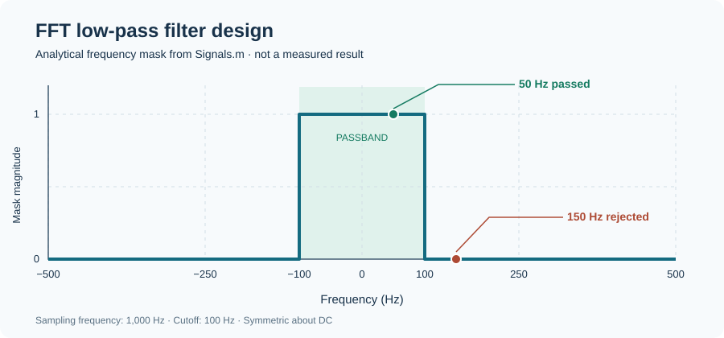
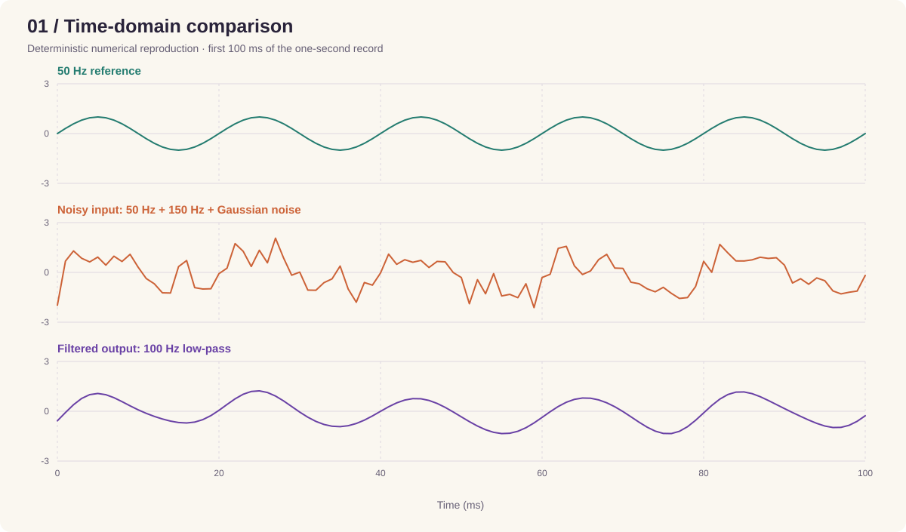
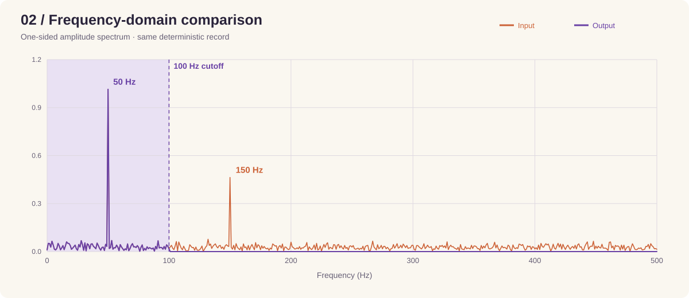

<div align="center">



# Signal Filtering Using Fourier Transforms


**Hassan Ali Janjua · Signals &amp; Systems · Air University, Islamabad**

[My approach](#the-idea-behind-this-project) · [Results](#results-and-observations) · [MATLAB code](Signals.m) · [Project report](Signals%20%26%20Systems%20Project%20Report.pdf)

</div>

## The idea behind this project

In my Signals & Systems project, I wanted to see how Fourier transforms could help separate useful information from unwanted components in a signal. Instead of trying to remove noise directly from the time-domain waveform, I moved the signal into the frequency domain, selected the frequencies I wanted to retain and reconstructed the signal using the inverse transform.

I used MATLAB to generate a synthetic signal, introduce random noise, inspect its spectrum and apply an ideal low-pass filter. The interesting part was seeing how a noisy waveform becomes much easier to understand once its frequency components are visible.

| Sampling frequency | Signal duration | Target frequency | Filter cutoff |
| :---: | :---: | :---: | :---: |
| 1,000 Hz | 1 s | 50 Hz | 100 Hz |

## My approach



### 01 / Generate the input signal

I combined a 50 Hz sinusoid with a smaller 150 Hz component, then added Gaussian random noise. The original MATLAB variable `signal` contains both sinusoids; for the quantitative comparison below, I use the 50 Hz component alone as the desired reference.

```math
x(t)=\sin(2\pi\,50t)+0.5\sin(2\pi\,150t)+0.5w(t)
```

Here, the samples of w are standard-normal random values. With a one-second record sampled at 1,000 Hz, the FFT bin spacing is 1 Hz.

### 02 / Inspect the frequency spectrum

I used the Fast Fourier Transform (FFT) and shifted the zero-frequency bin to the center of the spectrum. This made it straightforward to apply a symmetric frequency mask.

```matlab
N = length(noisy_signal);
frequencies = (-N/2:N/2-1)*(fs/N);
fft_result = fftshift(fft(noisy_signal, N));
```

### 03 / Apply the low-pass filter

I selected a 100 Hz cutoff to retain the 50 Hz component and remove the 150 Hz component. The filter keeps every bin between -100 Hz and +100 Hz, including the endpoints.



```matlab
low_pass_filter = zeros(1, N);
low_pass_filter(abs(frequencies) <= 100) = 1;
filtered_fft = fft_result .* low_pass_filter;
```

### 04 / Reconstruct the time-domain signal

The inverse FFT converts the retained spectrum back to the time domain. Because the mask is symmetric for the retained bins, the reconstructed signal is real apart from numerical roundoff.

```matlab
filtered_signal = ifft(ifftshift(filtered_fft));
```

## Results and observations

The figures below are calculated from a deterministic reproduction of the same signal and filter parameters, with a fixed noise sequence so the comparisons are repeatable. They are numerical results, not screenshots from my original MATLAB run. The original script uses unseeded `randn`, so its individual output varies.

### Time-domain response



The filtered signal follows the 50 Hz component more closely. It is not perfectly clean because random noise within the passband is retained.

### Frequency-domain response



The 50 Hz FFT bin is retained without attenuation by the mask, while the 150 Hz bin is set to zero. The plotted spectra use normalized one-sided amplitudes rather than the unnormalized two-sided magnitude in my original script.

### Quantitative comparison

| Metric | Noisy input | Filtered output |
| --- | ---: | ---: |
| RMSE relative to the 50 Hz reference | 0.5893 | 0.2344 |
| SNR relative to the 50 Hz reference | 1.58 dB | 9.59 dB |
| 50 Hz bin amplitude | 1.0145 | 1.0145 |
| 150 Hz bin amplitude | 0.4634 | 0.0000 |

For this fixed example, the SNR improves by **8.01 dB**. Here the error includes both the unwanted 150 Hz sinusoid and random noise. The values were calculated independently using the discrete Fourier transform and the identical mask; the MATLAB reproduction script has not been executed in MATLAB.

<details>
<summary><b>How I evaluate the filtering performance</b></summary>

The reference is the 50 Hz sinusoid, s. For an input or output waveform z, I use

```math
\mathrm{RMSE}=\sqrt{\frac{1}{N}\sum_{n=0}^{N-1}(z[n]-s[n])^2}
```

```math
\mathrm{SNR}=10\log_{10}\left(\frac{\sum_n s[n]^2}{\sum_n (z[n]-s[n])^2}\right)
```

[Numerical method and assumptions](docs/analysis.md)

</details>

## What I learned

This project helped me understand the relationship between the time domain and frequency domain. A filter does not automatically distinguish between desired and undesired information: it simply follows the frequency response I define. If unwanted noise lies inside the passband, an ideal low-pass filter cannot remove it without also affecting useful components.

The FFT mask is an offline, whole-record operation. It is not a causal streaming filter; a real-time application would need a different design, such as a realizable FIR or IIR filter.

## Run the MATLAB analysis

Open the repository folder in MATLAB and run:

```matlab
Signals
```

For repeatable plots and numerical comparisons against the 50 Hz reference, run:

```matlab
run('analysis/reproduce_filter.m')
```

The reproduction uses a fixed Park–Miller sequence and Box–Muller Gaussian noise instead of MATLAB's unseeded random generator. Both scripts use base MATLAB FFT functions.

| File | Purpose |
| --- | --- |
| [Signals.m](Signals.m) | My original MATLAB coursework script |
| [reproduce_filter.m](analysis/reproduce_filter.m) | Repeatable filtering and metric analysis |
| [Project report (PDF)](Signals%20%26%20Systems%20Project%20Report.pdf) | Original Signals & Systems report |
| [Analysis notes](docs/analysis.md) | Assumptions, equations and interpretation |
| [assets](assets) | Scientific illustrations and computed plots |

---

<div align="center">

**Hassan Ali Janjua**  
Mechatronics Engineering · MATLAB · Signal Processing

[My engineering portfolio](https://github.com/HassanAliJanjua03)

</div>
