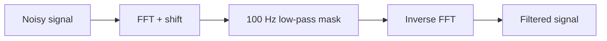

# Signal Filtering Using Fourier Transforms

**Digital Signal Processing · FFT · MATLAB**

A runnable MATLAB example demonstrating frequency-domain filtering of a synthetic signal corrupted by additive random noise.

## Engineering highlights

- Sampling frequency: 1,000 Hz; duration: 1 second.
- Sinusoidal components at 50 Hz and 150 Hz, plus Gaussian noise.
- FFT, centered frequency spectrum, ideal 100 Hz low-pass mask and inverse FFT.

## Project files

| File | Purpose |
| --- | --- |
| [Signals.m](Signals.m) | Original source or design file |
| [Signals & Systems Project Report.pdf](Signals%20%26%20Systems%20Project%20Report.pdf) | Original source or design file |

## How to explore or reproduce

Open MATLAB in the repository folder and run `Signals`. Inspect the time-domain and frequency-domain plots. The 50 Hz component should remain while the 150 Hz component is suppressed.

## Scope and limitations

Random noise is not seeded, so results vary. The filter also retains in-band noise; it is an offline ideal frequency-domain demonstration, not a causal real-time filter.

## Portfolio

[Hassan Ali Janjua — Engineering portfolio](https://github.com/HassanAliJanjua03)
